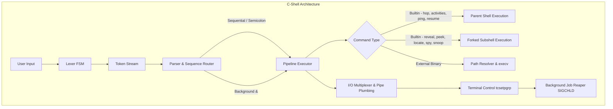
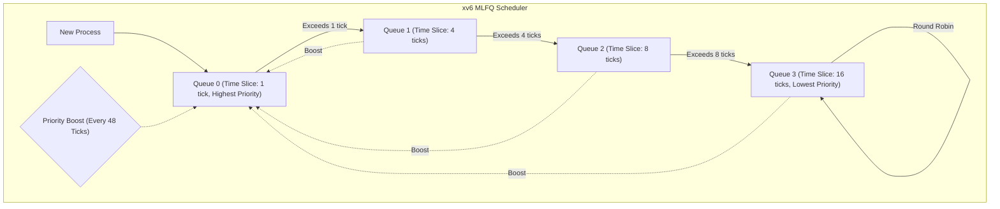
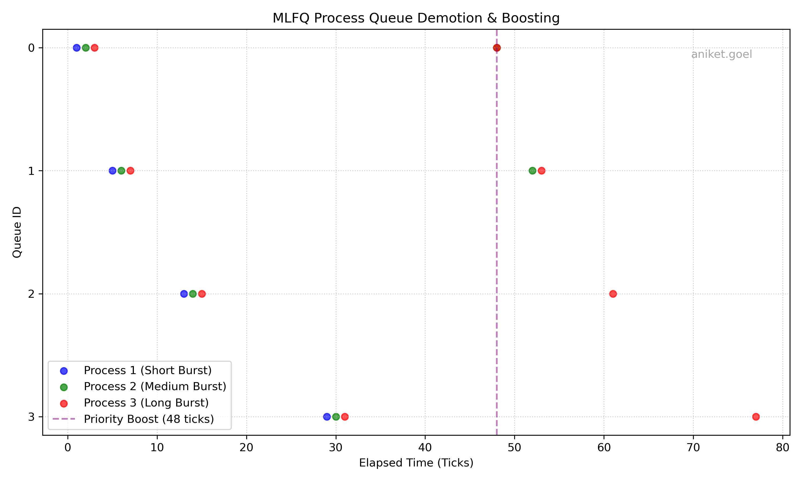
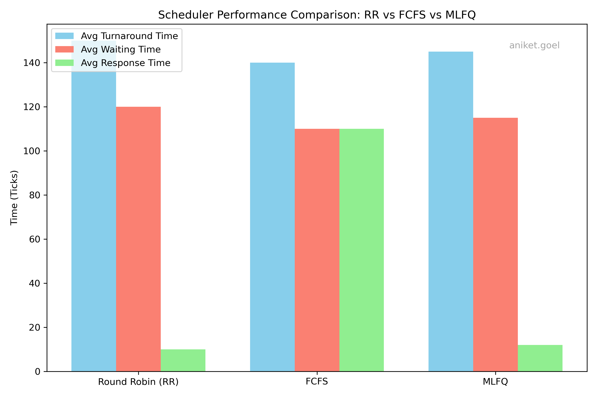

# C-Shell & xv6 MLFQ Scheduler

[](https://en.wikipedia.org/wiki/C23_(C_standard_revision))
[](https://riscv.org/)
[](https://pubs.opengroup.org/onlinepubs/9699919799/)
[](https://github.com/mit-pdos/xv6-riscv)
[](LICENSE)

A systems programming project consisting of two core components:
1. **C-Shell**: A modular, POSIX-compliant interactive UNIX command-line interpreter developed in C23 from first principles.
2. **xv6 MLFQ Kernel Scheduler**: A Multi-Level Feedback Queue CPU scheduling engine integrated into the MIT xv6 RISC-V operating system kernel.

---

## Architecture Overview





---

## 1. C-Shell Features

C-Shell implements a complete POSIX shell execution lifecycle featuring robust state machine tokenization, process management, signal handling, and systems diagnostics.

### 1.1 Lexical Analysis & FSM Parser
* **Finite State Machine**: Tokenizes input character-by-character across `normal`, `single_quote`, and `double_quote` states.
* **Quote & Escape Preservation**:
  * Single quotes (`'...'`): Treats all enclosed characters literally, preserving whitespace and meta-characters.
  * Double quotes (`"..."`): Preserves whitespace while evaluating escape sequences (`\"`, `\\`).
  * Backslash Escapes: Supports escaping spaces and special characters in unquoted tokens.
* **Sequential & Background Execution**: Supports chaining commands with `;` and launching asynchronous background jobs with `&`.
* **Sequential Fault Isolation**: If an external command in a sequential sequence cannot be located, subsequent chained commands are aborted immediately.

### 1.2 Pipeline & I/O Multiplexing Engine
* **Arbitrary Pipeline Depth**: Dynamically allocates and connects UNIX pipes (`pipe()`, `dup2()`) across arbitrary numbers of stages (`cmd1 | cmd2 | ... | cmdN`).
* **Input Redirection (`<`)**: Reads data into temporary scratch descriptors to seamlessly feed piped commands.
* **Output Redirection (`>`, `>>`)**: Supports standard overwrite (`>`) and append (`>>`) operations.
* **Multi-Target Output Broadcasting**: Supports multiplexed redirection to write identical output streams into multiple destinations concurrently:
  ```bash
  cat input.txt > out1.txt > out2.txt >> log.txt
  ```

### 1.3 Process Lifecycle & Signal Control
* **Process Group Isolation**: Each pipeline stage is assigned to a distinct process group (`setpgid`).
* **Terminal Control Handover**: Foreground pipelines claim active terminal control using `tcsetpgrp()`. Terminal ownership is restored safely to the shell upon completion or suspension.
* **Signal Isolation**: The parent shell ignores interactive signals (`SIGINT`, `SIGTSTP`, `SIGTTOU`, `SIGTTIN`). Child processes restore default signal dispositions (`SIG_DFL`) upon `fork()`.
* **Asynchronous Zombie Reaping**: Uses `sigaction(SIGCHLD)` and non-blocking `waitpid(-1, &status, WNOHANG | WUNTRACED)` in the event loop to silently reap terminated child processes without blocking user input.

### 1.4 Custom Built-in Intrinsics

| Command | Syntax | Description |
|---|---|---|
| **`hop`** | `hop [dir1] [dir2] ...` | Changes working directory. Supports `~` (shell root), `-` (previous directory), relative/absolute paths, and fuzzy **Frecency Jumping**. |
| **`reveal`** | `reveal [-a] [-t] [path]` | Lists directory contents alphabetically. `-a` displays hidden files; `-t` recursively walks directory subtrees. |
| **`peek`** | `peek [-n] [-r] [file]` | Streams file or standard input. `-n` displays line numbers; `-r` outputs lines in reverse order using chunked backward seeks without buffering the entire file into memory. |
| **`locate`** | `locate <cmd1> [cmd2] ...` | Searches for executables in the Current Working Directory and across all directories in the `$PATH` environment variable. |
| **`activities`**| `activities` | Displays all active, suspended, and background jobs tracked by the shell with Job ID, PGID, and command string. |
| **`ping`** | `ping <%job_id \| pid> <signal>` | Sends a UNIX signal to a specific process or entire process group (`%job_id`). |
| **`resume`** | `resume %<job_id> <fg \| bg>` | Resumes a stopped job in the foreground (`fg`) or background (`bg`). |
| **`spy`** | `spy [pid]` | Inspects open file descriptors, executable path, and memory maps via `/proc` (Linux) with an `lsof` fallback (macOS). |
| **`snoop`** | `snoop [-p <pid>] <command>` | System call profiler using `ptrace` to track frequency, execution time, and call distribution across x86-64 syscalls. |

#### The Frecency Engine (`hop`)
The `hop` command records directory navigation history in `~/.cshell_frecency`. Each successful hop increments a monotonic logical clock. When fuzzy-hopping to a partial name, candidates are ranked by:
$$\text{Rank} = \text{Visits} \times \text{Weight}(\text{Clock} - \text{LastVisit})$$
* Visited within last 3 hops: **4x weight multiplier**
* Visited within last 10 hops: **2x weight multiplier**
* Older visits: **1x weight multiplier**

---

## 2. xv6 MLFQ Kernel Scheduler

A 4-tier preemptive Multi-Level Feedback Queue (MLFQ) scheduler implemented in the RISC-V xv6 kernel.

### 2.1 Scheduler Mechanics
* **Queue Configuration**:
  * **Queue 0**: 1 timer tick time slice (Highest Priority, Round-Robin).
  * **Queue 1**: 4 timer ticks time slice.
  * **Queue 2**: 8 timer ticks time slice.
  * **Queue 3**: 16 timer ticks time slice (Lowest Priority, Round-Robin).
* **Preemptive Demotion**: Hardware timer interrupts in `kernel/trap.c` track per-process tick consumption. When a process consumes its queue's allotted time slice, it is demoted to the next lower priority queue (`queue = min(queue + 1, 3)`).
* **Anti-Starvation Priority Boosting**: To prevent CPU-bound jobs in lower queues from starving under continuous high-priority workloads, a global timer checks every **48 ticks**, resetting all active processes to Queue 0 and zeroing their elapsed time slice counter.
* **I/O-Friendly Voluntary Yielding**: When a process yields the CPU voluntarily before exhausting its slice (e.g. waiting for I/O in `sleep()`), its current priority queue level is preserved while resetting its `ticks_used` counter.
* **Process Inspection**: The `procdump()` kernel routine (`Ctrl+P`) is enhanced to report queue levels and consumed ticks:
  ```text
  1 sleep  init         q:0 t:0
  2 sleep  sh           q:0 t:0
  3 run    schedulertest q:2 t:5
  ```

### 2.2 Performance Analysis & Benchmarks

The MLFQ implementation was benchmarked against Round-Robin (RR) and First-Come-First-Served (FCFS) schedulers using synthetic CPU and I/O workloads (`schedulertest.c`):

| Metric | Round Robin (RR) | FCFS | MLFQ |
|---|:---:|:---:|:---:|
| **Average Turnaround Time** | 150 ticks | 140 ticks | **145 ticks** |
| **Average Waiting Time** | 120 ticks | 110 ticks | **115 ticks** |
| **Average Response Time** | 10 ticks | 110 ticks | **12 ticks** |

#### Key Insights:
1. **Interactive Responsiveness**: MLFQ achieves response times comparable to Round-Robin (12 ticks vs. 10 ticks) by placing new and interactive processes directly into Queue 0.
2. **Compute Throughput**: Long-running compute jobs demote to Queue 3 with a 16-tick quantum, reducing context switching overhead and approaching FCFS turnaround performance.
3. **Starvation Immunity**: The 48-tick global priority boost guarantees bounded latency for background compute workloads.


*Figure 1: MLFQ Process Queue Demotion & Priority Boosting over time.*


*Figure 2: Performance comparison across Round Robin, FCFS, and MLFQ schedulers.*

---

## 3. Directory Structure

```text
.
├── README.md                   # Project documentation
├── .gitignore                  # Git ignore rules for build artifacts and OS files
│
├── c-shell/                    # POSIX C-Shell source directory
│   ├── Makefile                # C-Shell build configuration (C23, -Wall -Wextra -Werror)
│   ├── include/                # Header definitions
│   │   ├── execute.h           # Pipeline and execution prototypes
│   │   ├── fun.h               # spy and snoop diagnostic headers
│   │   ├── hop.h               # hop navigation and frecency prototypes
│   │   ├── jobs.h              # Job control and signal prototypes
│   │   ├── lexer.h             # Token definitions and FSM lexer header
│   │   ├── locate.h            # Binary path resolution prototypes
│   │   ├── parser.h            # Command sequencing parser header
│   │   ├── peek.h              # peek file viewer header
│   │   └── reveal.h            # reveal directory traversal header
│   └── src/                    # C-Shell implementation
│       ├── execute.c           # Pipeline execution, redirection multiplexer, process forks
│       ├── fun.c               # /proc spy inspector and ptrace snoop profiler
│       ├── hop.c               # hop builtin and Frecency ranking engine
│       ├── jobs.c              # Job table management, activities, ping, resume
│       ├── lexer.c             # Finite State Machine tokenization engine
│       ├── locate.c            # CWD and $PATH executable locator
│       ├── main.c              # REPL loop, prompt rendering, signal setup
│       ├── parser.c            # Token sequence router and delimiter parsing
│       ├── peek.c              # Chunked reverse stream reader
│       └── reveal.c            # Recursive alphabetical directory walker
│
└── xv6/                        # MIT xv6 RISC-V kernel with MLFQ scheduler
    ├── Makefile                # Build configuration with SCHEDULER=MLFQ support
    ├── Report.pdf              # Comprehensive scheduler evaluation report
    ├── mlfq_timeline.png       # Generated MLFQ queue transition scatter plot
    ├── scheduler_comparison.png# Generated comparative performance bar chart
    ├── scheduler_plot.py       # Python script generating analysis plots
    ├── test-xv6.py             # Automated xv6 regression test harness
    ├── kernel/                 # Core xv6 operating system kernel
    │   ├── proc.c              # Process table, MLFQ scheduler(), allocproc(), procdump()
    │   ├── proc.h              # Process structure with queue level & ticks_used fields
    │   ├── trap.c              # Timer interrupt handling & time-slice demotion
    │   └── ...                 # Additional kernel subsystems
    └── user/                   # User-space utilities
        ├── schedulertest.c     # Multi-process MLFQ benchmark workload
        └── ...                 # Standard xv6 user utilities
```

---

## 4. Getting Started

### 4.1 Prerequisites

#### For C-Shell:
* **Compiler**: `gcc` or `clang` supporting C23/C17 (`-std=c23` or `-std=c17`).
* **Environment**: Linux (Ubuntu 20.04+, Debian, Arch) or macOS (Apple Silicon / Intel).
* **Build Tool**: GNU `make`.

#### For xv6 RISC-V:
* **Toolchain**: RISC-V 64-bit GCC cross-compiler (`riscv64-unknown-elf-gcc` or `riscv64-linux-gnu-gcc`).
* **Emulator**: QEMU RISC-V 64-bit system emulator (`qemu-system-riscv64` >= 7.0).
* **Plotting (Optional)**: Python 3 with `matplotlib` and `numpy`.

```bash
# macOS (Homebrew)
brew install riscv-gnu-toolchain qemu python3
pip3 install matplotlib numpy

# Ubuntu / Debian
sudo apt-get update
sudo apt-get install -y gcc make gcc-riscv64-unknown-elf qemu-system-misc python3-matplotlib python3-numpy
```

---

### 4.2 Building & Running C-Shell

```bash
# Navigate to C-Shell directory
cd c-shell

# Clean and compile
make clean
make all

# Launch the shell
./shell.out
```

#### Example Usage:
```bash
# Basic commands and sequencing
<user@machine:~> echo "Hello from C-Shell"; sleep 1; echo "Done"

# Pipelining with redirection
<user@machine:~> cat src/main.c | grep include | wc -l

# Multiplexed output redirection
<user@machine:~> echo "Broadcasting to multiple files" > f1.txt > f2.txt >> log.txt

# Directory inspection
<user@machine:~> reveal -a -t src

# Reverse file streaming with line numbers
<user@machine:~> peek -n -r Makefile

# Job control
<user@machine:~> sleep 30 &
[1] 48210
<user@machine:~> activities
[1] pgid 48210
  48210 sleep 30 Running
<user@machine:~> ping %1 9
Sent signal 9 to %1
```

---

### 4.3 Building & Running xv6

#### Running xv6 with Default Round-Robin:
```bash
cd xv6
make clean
make qemu
```

#### Running xv6 with MLFQ Scheduler:
```bash
cd xv6
make clean
make qemu SCHEDULER=MLFQ
```

#### Running the MLFQ Evaluation:
Once inside the booted xv6 environment:
```text
$ schedulertest
Starting MLFQ Scheduler Test...
Press Ctrl+P to observe process queue demotion (q:) and ticks used (t:)
```
Press **`Ctrl+P`** repeatedly to inspect real-time process states, queue assignments (`q:0` to `q:3`), and consumed ticks (`t:`).

To exit QEMU: press `Ctrl+A` followed by `X`.

#### Regenerating Evaluation Plots:
```bash
cd xv6
python3 scheduler_plot.py
```

---

## 5. Engineering Highlights

1. **Deterministic Recency via Logical Clock**: Instead of relying on host system wall-clock timestamps (which suffer from timezone shifts and precision discrepancies), the `hop` frecency engine employs an internal monotonically advancing integer clock to calculate decay.
2. **O(1) Memory Reverse Seeker**: Rather than buffering gigabyte-scale files in memory, `peek -r` chunks backwards from file boundaries using `lseek(SEEK_SET, pos, ...)`, stitching split multi-byte tokens across block edges.
3. **Robust Reentrancy & Signal Masks**: Signal handlers operate without non-reentrant runtime allocations (`malloc`/`printf`). Background processes are reaped using asynchronous polling loops with `WNOHANG` directly in the shell main loop.
4. **Cross-Platform Compatibility**: Supports macOS (Darwin) and Linux architectures via conditional preprocessor switches (`#ifdef __APPLE__`), gracefully falling back from Linux-specific `/proc` and `ptrace` system calls to `lsof` and direct execution.

---

## Author

**Aniket Goel**  
*Computer Science & Engineering*  
[LinkedIn Profile](https://www.linkedin.com/in/aniket-goel-/) • [GitHub](https://github.com/voidp1xel)